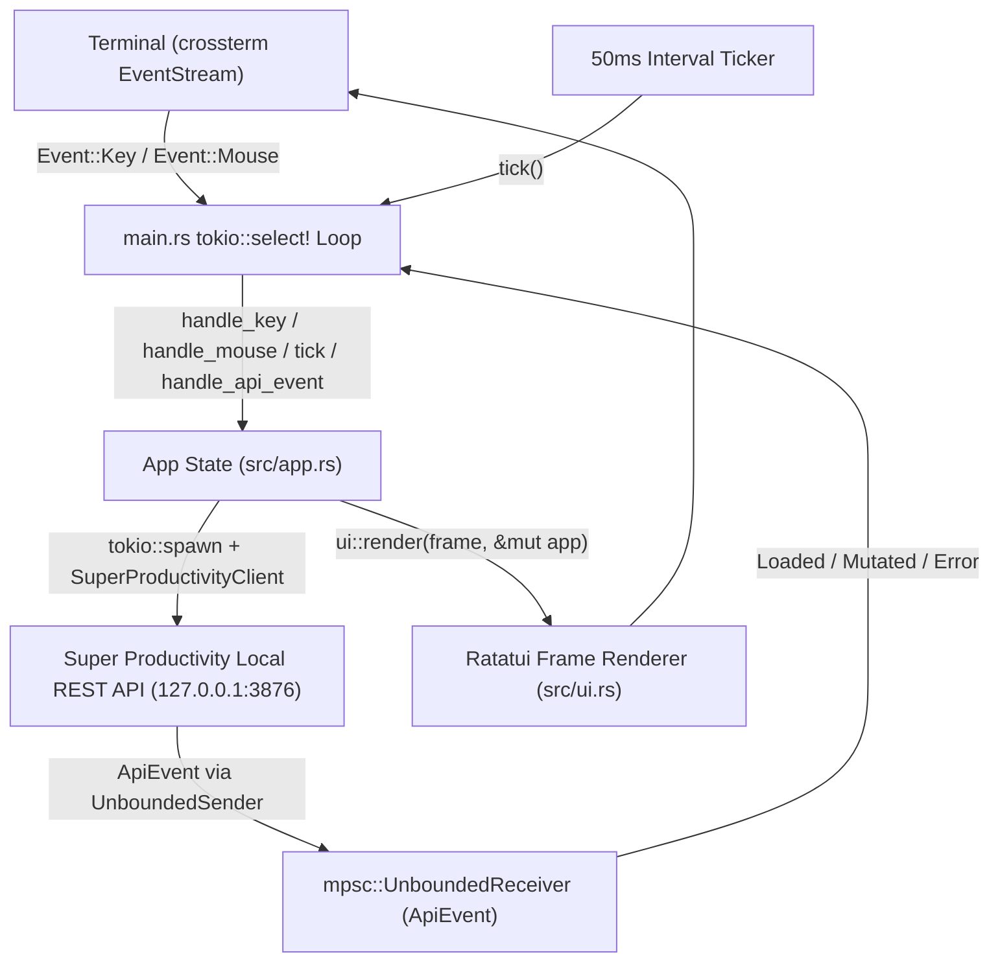
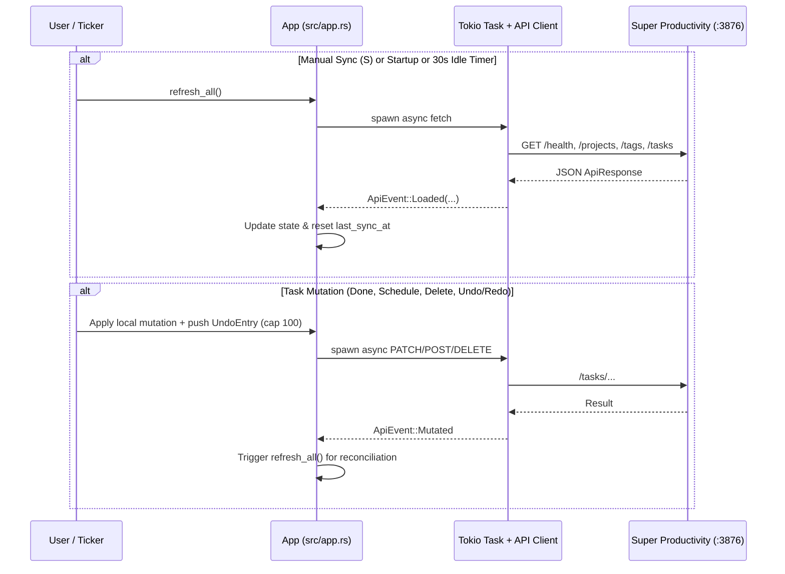
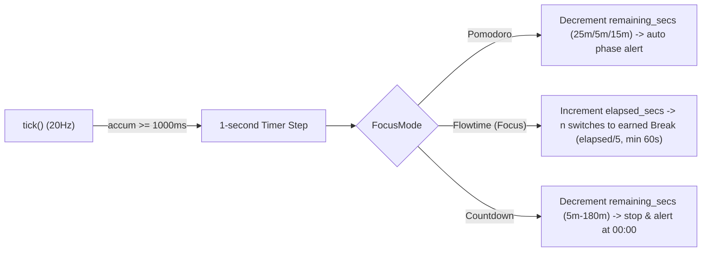

# Developer Documentation (`README_DEV.md`)

Technical architecture, module map, data flows, and contributor notes for **Super Productivity TUI**.

---

## Architecture Overview

Super Productivity TUI follows an asynchronous **Elm / TEA-inspired (Model–View–Update)** architecture driven by `tokio::select!`:

- **State & Update**: [`src/app.rs`](src/app.rs) owns the single source of truth (`App`) and dispatches input events (`handle_key`, `handle_mouse`), timer ticks (`tick`), and async API results (`handle_api_event`).
- **View**: [`src/ui.rs`](src/ui.rs) performs pure immediate-mode rendering against `&App` via `ratatui::Frame`.
- **Side Effects**: [`src/api.rs`](src/api.rs) wraps `reqwest::Client` calls on spawned Tokio tasks and returns results through an unbounded `mpsc` channel (`ApiEvent`).



---

## Module Structure

| File | Responsibility |
| :--- | :--- |
| [`src/main.rs`](src/main.rs) | Raw terminal setup/teardown, `tokio::select!` event loop (50ms tick, `EventStream`, `api_rx`). |
| [`src/app.rs`](src/app.rs) | `App` state, modal routing, key/mouse handlers, 100-entry undo/redo stack, 30s auto-sync timer, `PomodoroState` (`Pomodoro`, `Flowtime`, `Countdown`), Worklog & Reschedule state. |
| [`src/ui.rs`](src/ui.rs) | Layout splits (sidebar, task list, inspector/details, status bar) and overlays (Add Task, Properties dropdown, Reschedule calendar, Focus Timer, History, Counters, Theme Editor + 2D Color Picker, `:h` Help). |
| [`src/api.rs`](src/api.rs) | `SuperProductivityClient` HTTP methods (`health`, `list_projects`, `list_tags`, `list_tasks`, `create_task`, `update_task`, `delete_task`, `toggle_task_done`, `start_tracking`, `stop_tracking`, counters/entity fallbacks). |
| [`src/models.rs`](src/models.rs) | Serde models (`Task`, `Project`, `Tag`, `SimpleCounter`, `CreateTaskPayload`, `ApiResponse`, hex color helpers). |
| [`src/short_syntax.rs`](src/short_syntax.rs) | Token parser for `+project`, `#tag`, `t<duration>[/<estimate>]`, `@due`, `!deadline`, compound duration parser (`1h5m3s`, `2d`), and floating autocomplete extraction. |
| [`src/keybinds.rs`](src/keybinds.rs) | Sectioned `KeybindEntry` registry for `:h`, `KeybindSequenceBuffer` (`jk` to Esc, `gg` sequence), and mode filtering (`Both`, `NVIM`, `Normal`). |
| [`src/theme.rs`](src/theme.rs) | `ThemeConfig`, 21 built-in presets (including `AMOLED`), HSV/RGB 2D map math (`map_coords_to_rgb`, `rgb_to_map_coords`, `parse_rgb`, `format_hex`). |
| [`src/config.rs`](src/config.rs) | TOML persistence (`AppConfig::load`, `AppConfig::save`) under the OS config directory (`super-productivity-tui/config.toml`). |

---

## Key Workflows

### 1. Sync & Mutation Flow

Data stays synchronized without blocking the UI thread:



### 2. Focus Timer Modes (`FocusMode`)

`PomodoroState` accumulates 50ms ticks via fractional `tick_accum_ms` until 1000ms (1 second) passes:



### 3. Input Routing & Key Sequences

1. **Windows Key Release Filtering**: `App::handle_key` ignores `KeyEventKind::Release` and `KeyEventKind::Repeat` events (except navigation repeats if needed) so Windows terminals do not double-trigger actions.
2. **Escape Sequence (`jk`)**: Inside text/dropdown/modal contexts configured for `jk`, `KeybindSequenceBuffer` holds `j` briefly so `j` + `k` maps to `Esc`, while any other key flushes `j` cleanly.
3. **Command Bar (`:`)**: Commands are parsed in `execute_command` (`:c`, `:h`, `:s`, `:p`, `:hist`, `:cnt`, `:q`).

---

## Known API Constraints

- **Project & Tag Creation (`Route not found`)**: Super Productivity's Local REST API exposes `GET /projects` and `GET /tags` along with full `GET/POST/PATCH/DELETE /tasks`, but does not currently expose `POST /projects` or `POST /tags`. When `POST` fails with a route error, `App` creates the Project/Tag in the local session so tasks can still be tagged and grouped immediately.
- **Worklog / Counters Fallbacks**: Time-tracking totals (`timeSpent`) are aggregated directly from synced tasks (`Project` and `Tag` attribution), while `SimpleCounter` defaults and updates persist cleanly into `config.toml` when backend counter endpoints are unavailable.

---

## Development & Verification

Before committing any change, run the full check pipeline:

```bash
cargo fmt --all
cargo clippy --all-targets --all-features -- -D warnings
cargo test --all-features
```

### Commit & Report Conventions

- Keep commits atomic using [Conventional Commits](https://www.conventionalcommits.org/) (`feat:`, `fix:`, `docs:`, `refactor:`, `test:`).
- Record notable implementation/verification summaries as concise Markdown reports under `reports/`.
- Keep `chat_log/` local-only (gitignored).
